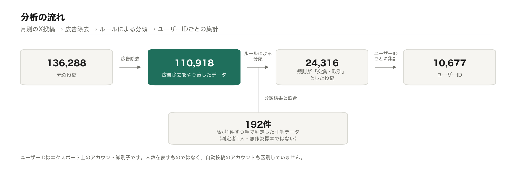
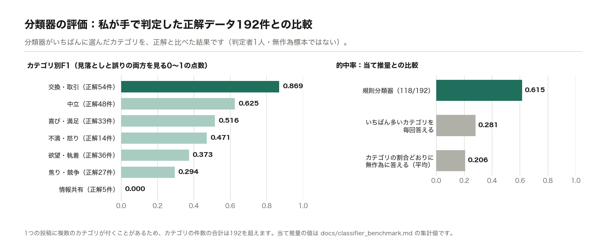

# Bonbon Drop Seal Social Media Analysis

[](https://github.com/bsw0610/sns-analysis/actions/workflows/test.yml)

4人の大学ゼミで、「ボンボンドロップシール」に関するX投稿を分析しました。2025年11月〜2026年4月に収集された**136,288件**を対象に、広告除去、テキスト処理、Word2Vec、投稿の感情・行動分類、交換投稿の分析を行いました。私の担当は投稿ごとの感情分析です。

発表直前の確認で、広告除去後に除外結果を確認する工程がなく、必要な投稿も消えていたことが分かりました。私の担当部分に使うデータを作り直し、自分で判定した正解データと分類結果を照合しました。コード、テスト、CI、文書は、私の指示と承認のもとでAIコーディングエージェントが書きました。

This repository documents a four-person seminar study and the repository owner's
individual follow-up: a rule-based post classifier, its evaluation, and the
reconstruction and verification of the analysis. The collected posts are not
published; a synthetic example is runnable below.

<a id="日本語概要"></a>
<a id="motivation-and-background"></a>
<a id="overview"></a>
<a id="data-scope"></a>
<a id="original-word-level-workflow"></a>
<a id="methodology"></a>

## Key Results

- 元の投稿は**136,288件**。広告除去を見直した結果は**110,918件**で、以前の
  109,037件に対し2,015件が戻り、134件が新たに外れました。
- 元のコードが残っていない除外判断**391件**は、推測で再実装せず投稿IDで固定しました。
- 正解データ**192件**を私が1件ずつ手で判定しました。判定者は1人で、現在の
  コーパスの無作為標本ではありません。
- 分類器の的中率は**0.615（118/192）**。最多カテゴリを毎回答える場合は0.281です。
  最も当てはまる1カテゴリで見たF1は「交換・取引」**0.869**、
  「情報共有」**0.000**（正解データ中5件）でした。
- 規則が「交換・取引」とした投稿は**24,316件**、そのユーザーIDは**10,677件**です。
  これは分類結果であり、実際に成立した取引の数ではありません。



[分析の流れを拡大](assets/portfolio/01_pipeline.png)



[分類器の評価を拡大](assets/portfolio/04_classifier_evaluation.png)

<a id="advertising-removal-and-hybrid-corpus"></a>

### Advertising removal and exchange activity

元の広告除去では、分類器が「情報共有」とする投稿が広いキーワードにより偏って除かれていました。これは分類器の出力に基づく観察です。[フィルタ監査の図](assets/portfolio/02_filter_audit.png)と[再構築の詳細](docs/hybrid_rebuild.md)に内訳を示します。

<a id="exchange-analysis"></a>

「交換・取引」と分類された24,316件について、10,677ユーザーIDのうち7,198 ID（**67.4%**）は1件だけ投稿しました。投稿数上位1%のIDが3,619件（**14.9%**）、上位10%が11,082件（45.6%）を占めます。指定した交換形式に一致する投稿は12,411/24,316件（**51.0%**）でした。分類規則と形式判定は一部の記号を共有するため、この割合は分類の独立した検証ではありません。IDはアカウントであり、人数を表しません。[集中度の図](assets/portfolio/03_exchange_concentration.png) ·[形式の定義と限界](docs/slide_metric_audit.md#structured-exchange-format)

<a id="rule-based-classification"></a>
<a id="human-label-evaluation"></a>
<a id="results"></a>
<a id="classifier-evaluation-both-label-sets"></a>

### Classifier evaluation

分類器は固定キーワード規則を使い、AIモデル自体ではありません。正解データは旧コーパスからの189件と追加3件で構成されます。追加3件の判定時期・手順は記録に残っていません。判定者間の一致率は測っていません。

| Evaluation criterion | Metric | Gold 189 | Gold 192 |
| --- | --- | ---: | ---: |
| Multi-label threshold | Micro F1 | 0.594 | 0.595 |
| Multi-label threshold | Macro F1 | 0.496 | 0.495 |
| Lenient primary-label match | Micro F1 | 0.576 | 0.577 |
| Lenient primary-label match | Macro F1 | 0.451 | 0.450 |
| Lenient primary-label match | Hit rate | 116/189 = 0.614 | 118/192 = 0.615 |
| Multi-label threshold | Exact match | — | 103/192 = 0.536 |

前者は閾値以上の全カテゴリを採点し、後者は最高得点の1カテゴリが正解ラベルのいずれかに含まれれば正解とします。分母は各正解データ集合であり、110,918件全体ではありません。両集合に共通する189件の予測は同じです。[評価方法とカテゴリ別の誤り](docs/baseline_evaluation.md)を参照してください。

同じ正解データでの比較では、規則とTF-IDF＋ロジスティック回帰の双方が当て推量を上回りました。学習モデルの的中率0.542と規則0.615の差は判断保留、macro F1は0.340対0.450で学習モデルが低い結果でした。小標本・1設定・調整なしの比較であり、規則が学習モデル一般より優れるとは言えません。[ベンチマーク集計と条件](docs/classifier_benchmark.md)

## Try It Without the Dataset

Python 3.9以上と標準ライブラリで、公開された合成投稿30件を分類できます。研究データや追加パッケージは不要です。リポジトリのルートで実行してください。

```bash
python3 classify_sns_rule_based.py \
  --input sample_data/sample_posts.csv \
  --output sample_output.csv

python3 sample_data/check_sample_output.py sample_output.csv
```

```text
OK: 30 rows classified, 21/30 match the intended label
OK: 9 known disagreements reproduced exactly
```

意図ラベルとの不一致9件は既知の弱点を示すためのものです。[サンプルの説明](sample_data/README.md)に各原因があります。これは合成例の動作確認であり、Gold 192による評価や研究全体の再現ではありません。CIは5つのテストモジュールとこのサンプルを実行します。

<a id="ai-workflow"></a>
<a id="aiに実装を任せ別の目で確かめた進め方"></a>
<a id="team-project-context"></a>
<a id="my-contributions"></a>
<a id="source-material-and-contribution-boundaries"></a>

## Team, individual, and AI contributions

データ準備、初期の広告除去、探索、ゼミ発表は4人のチーム作業です。このリポジトリは元の共同研究の単独著作を主張しません。初期段階の個別担当を示す記録は残っていません。

私自身は正解データ192件の手作業判定、抽出標本による広告除去の確認、391件のID固定、利用する結果と公開範囲の決定、各段階の承認を担いました。発表前に「情報共有」の精度がほぼゼロだとチームに伝え、私の発表担当部分に限り、最もF1の高かった「交換・取引」の結果と再構築データ・評価を使いました。

AIエージェントは私の指示と承認のもとで、フィルタ監査と再構築、分類・評価、交換分析、検証、コード、テスト、CI、文書を書きました。コードと検査の判定もAIが行いました。ベンチマークには別セッションや別モデルによるレビューを使い、利用制約による分担変更もありました。その経緯はAIが書いた非公開作業記録に基づき、公開リポジトリからは検証できません。[役割・資料出典・AI作業の詳細](docs/contributions.md)

<a id="limitations"></a>

## Limitations and public scope

- Gold 192は小さな非無作為標本で判定者は私1人です。補充3件の判定経緯と、
  規則が正解ラベルを見た後に変更されたかは不明です。全コーパスへの性能の
  一般化はできず、カテゴリの採用基準値も事前には決めていませんでした。
- 日本語の活用・否定・類義語・規則の相互作用に弱点があり、特に「焦り・競争」
  と「情報共有」の性能が低い結果でした。
- 収集投稿、生成データ、Goldラベルは公開していません。研究の完全な再実行には
  Gitに含まれない入力が必要です。ベンチマークは集計要約のみ公開し、コード・
  投稿ごとの出力・作業履歴は公開していません。
- 研究室提供Notebookは再配布条件を確認できず公開していません。元の検索条件や
  一部のデータ系譜、MeCab環境、旧Word2Vecの再学習条件にも未解決点があります。
  [実行環境と過去の方法](docs/reproducibility.md#historical-data-and-methods)

<a id="reproducibility-and-how-to-run"></a>
<a id="requirements"></a>
<a id="execution-environments"></a>
<a id="rebuild-the-hybrid-corpus"></a>
<a id="run-the-classifier"></a>
<a id="normalize-the-gold-192-dataset"></a>
<a id="verify-the-rebuild"></a>
<a id="regenerate-the-readme-figures"></a>
<a id="run-unit-tests"></a>
<a id="tech-stack"></a>
<a id="repository-structure"></a>
<a id="scripts"></a>

## Documentation and repository

- [Documentation index](docs/README.md): 結果、実行、研究経緯の読み順。
- [Reproducibility and execution](docs/reproducibility.md): 環境、非公開入力、
  再構築・検証コマンド、過去の分析手順。
- [Script reference](docs/scripts.md): ルートの各Pythonファイルの役割。
- [Contributions and sources](docs/contributions.md): チーム・本人・AIの役割と資料出典。
- [Project timeline](docs/01_PROJECT_TIMELINE.md) ·
  [Classifier evaluation](docs/baseline_evaluation.md) ·
  [Benchmark summary](docs/classifier_benchmark.md) ·
  [Presentation metric audit](docs/slide_metric_audit.md)

```text
.
├── README.md, LICENSE, requirements.txt
├── .github/workflows/test.yml    # tests and synthetic sample
├── assets/portfolio/             # published figures
├── baselines/                    # final-filter ID lock
├── sample_data/                  # synthetic posts and checker
├── docs/                         # documentation index and detailed reports
└── *.py                          # pipeline, verification, tests and utilities
```

<a id="future-work"></a>

## License

Code is released under the [MIT License](LICENSE). It does not cover the
collected posts or the lab-provided notebooks, neither of which is distributed here.
